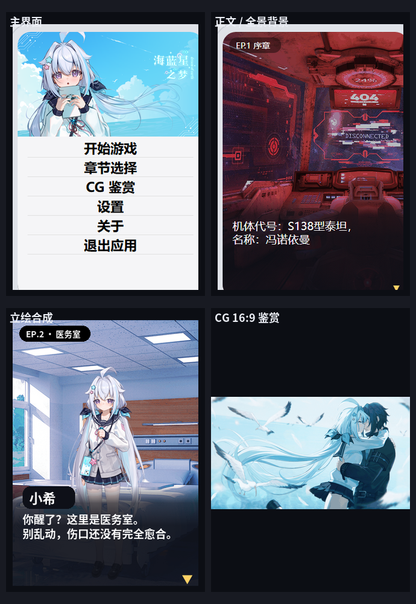

# 海蓝星之梦 · 小米手环 9 Pro 版

把 PC 版 Ren'Py 视觉小说 **《海蓝星之梦》** 移植成 **小米手环 9 Pro**（336×480 矩形 AMOLED）的 **Vela 快应用**。

> **引擎与 UI**
>
> 剧本解释器、分块阅读器、固定槽位立绘、`protected` 页面状态和 `storage` 存档结构参照开源工程 [thewhitenightInlatesummer-band](https://github.com/mcpotato1123/thewhitenightInlatesummer-band)。
>
> 主界面使用原作 `images/gui/game_menu.png` + `images/gui/main_menu.png` 合成；App 图标使用原作 `images/gui/window_icon.png`。

```
剧本数据  14,944 条指令 / 13 章 / 117 个分块（每块 128 条）
对话      10,070 句
美术      背景 80 张（672×480 JPEG）· 立绘 21 个标签 / 218 张差分 · CG 17 张（853×480）
主界面    336×189 完整 16:9 原图横幅 + 下方浅色菜单板
正文      672×480 全景背景，4px / 100ms 左右往返平移
分支      21 个菜单
页面      7 个：主页 / 正文 / 章节 / 存档 / CG 鉴赏 / 设置 / 关于
协议      代码 MIT（见 LICENSE）；剧本与美术不在 MIT 范围内（见 NOTICE.md）
产物      dist/海蓝星之梦_小米手环9Pro_v1.0.rpk   9.96 MB
```



> **免责声明**：本项目是非官方的个人移植，仅供学习交流。
>
> 剧本文字与全部美术资源（背景 / 立绘 / CG）版权归《海蓝星之梦》原作方所有，请勿用于商业用途。
>
> 代码部分采用 MIT；详见文末「九、版权与开源协议」。

---

## 故事简介

> 以下为原作设定简介，含轻度剧透。

飞船坠落在未知的蔚蓝星球。失去名字的旅人从医务室醒来，身边是熟睡的白发少女小希。

这里看似安宁，却藏着泰坦集团、失控的机械与一段被遗忘的过去。玩家将以「无名」的身份，在这个夏天做出选择。

### 主要角色

| 角色 | 简介 |
|---|---|
| **无名**（主角） | 没有名字的旅人；开口时显示「无名」，内心独白为「我（心声）」 |
| **小希** | 白发少女，故事的核心女主角；立绘标签 `xiaox_1` / `xiaox_2` |
| **影** | 与主角命运交错的关键角色；立绘标签 `ying_1` / `ying_2` / `ying_3` |
| **希娅** | 立绘标签 `xiya_1` |
| **DeepSleep** | 机器人角色；脚本内标识 `b`，立绘 `deep_*` |
| **五号 / 阿尔法 / 变异机器人** | Deep 系列的其他形态；立绘 `v_deep` / `a_deep` / `err_deep_*` |
| **希 / 辰火 / 记者 / 同学 / 老师等** | 配角与支线人物 |

剧本按 EP.1–EP.11、NE 线、DLC 番外的顺序组织，共 13 章。

---

## 一、目录结构

```text
blueplanet-band/
├─ package.json                 npm 脚本与 aiot-toolkit 依赖
├─ package-lock.json
├─ LICENSE                      代码 MIT
├─ NOTICE.md                    素材版权说明
├─ README.md
├─ dist/
│  └─ 海蓝星之梦_小米手环9Pro_v1.0.rpk
├─ preview/                     界面预览、原作主界面合成参考
├─ src/                         快应用源码（Vela 固定目录名）
│  ├─ manifest.json             包名 / 图标 / 路由 / designWidth
│  ├─ app.ux
│  ├─ common/
│  │  ├─ vm.js                  剧本解释器（纯逻辑）
│  │  ├─ reader.js              字号、分页、存档、设置
│  │  ├─ assets.js              ← 生成：背景 / CG / 立绘索引
│  │  ├─ theme.js
│  │  ├─ icon.png               ← 生成：原作 window_icon + 圆角
│  │  ├─ img/
│  │  │  ├─ b/*.jpg             背景 80 张，672×480
│  │  │  ├─ s/<tag>/            base.png + face__*.png + meta.json
│  │  │  ├─ w/*.png             CG 17 张，853×480
│  │  │  ├─ t/*.png             CG 缩略图 96×54
│  │  │  └─ ui/                 title_bg / board / headbar / footbar / locked
│  │  └─ story/
│  │     ├─ index.txt           章节表 + 分块表（JSON 内容，.txt 扩展名）
│  │     └─ chunk-000.txt…      117 个指令分块
│  └─ pages/
│     ├─ index/                 主页：开始 / 继续 / 章节 / CG / 设置 / 关于 / 退出
│     ├─ game/                  正文阅读器（全景背景 + 立绘 + 打字机）
│     ├─ chapters/              章节选择（13 章）
│     ├─ saves/                 6 个手动槽 + 自动存档
│     ├─ cg/                    CG 鉴赏（853×480 长图，左右拖动）
│     ├─ settings/              字号 / 速度 / 自动播放 / 屏幕常亮 / 长按
│     └─ about/                 简介、操作提示、解锁面板
├─ sim/                         浏览器模拟器（file:// 直接打开）
│  ├─ index.html                336×480 表盘壳
│  ├─ app.js
│  ├─ vm.bundle.js              ← 生成
│  ├─ assets.bundle.js          ← 生成
│  └─ data.js                   ← 生成：整份剧本
└─ tools/
   ├─ build_story.py            Ren'Py AST → 分块指令流
   ├─ build_assets.py           原作素材 → 手环资源
   ├─ build_sim.py              生成 sim/ 三份数据
   ├─ build.js                  aiot 构建包装 + 产物校验
   ├─ game_assets.py            资源索引与 Ren'Py 名称映射
   └─ rpyc_ast.py               只读 .rpyc AST 读取器
```

仓库已经带了生成好的剧本、背景、立绘和 CG。只想改代码或重新打包时，**不需要 PC 原版**。

---

## 二、构建

环境：Node.js + npm；快应用使用 `aiot-toolkit 2.0.5`。

```bash
npm install
npm run build          # 等同于 node tools/build.js，产物在 dist/
# 或直接：
npx aiot build
```

生成的文件：

```text
dist/com.blueplanet.dream.band.debug.1.0.rpk
```

仓库里的 `dist/海蓝星之梦_小米手环9Pro_v1.0.rpk` 就是这个 debug 包，可以直接侧载。

### 从 PC 原版重新生成剧本 / 图片

需要 Python 3 + Pillow，以及 PC 版解包目录 `../unpacked`：

```bash
python tools/build_story.py     # .rpyc → src/common/story
python tools/build_assets.py    # 背景 / 立绘 / CG / 图标 → src/common/img
python tools/build_sim.py       # 刷新 sim/ 的剧本与资源索引
npx aiot build
```

`tools/game_assets.py` 默认从 `../unpacked` 读取：

- `01_立绘/分层素材`
- `02_背景`
- `03_CG`
- `extracted/msvcp140`
- `extracted/DLC`

### Windows 上的已知问题

`aiot` 在 Windows 上收尾清理临时工程时可能报 `EPERM`（临时目录里的 `node_modules` 链接无法删除），但 **rpk 已经生成**。本仓库的 `tools/build.js` 会校验产物；也可直接查看 `dist/`。

---

## 三、安装到手环

`.rpk` 是 **debug 包**，可侧载：

1. 手机安装 **Astrobox**
2. 【设置】→【账号与安全】→ 登录小米账号 → 导入在小米运动健康绑定的设备 → 连接手环
3. 【探索】→【安装快应用】→ 选择 `dist/海蓝星之梦_小米手环9Pro_v1.0.rpk`
4. 等进度跑完，手环应用列表出现 **海蓝星之梦**

> 官方真机调试目前只支持 Xiaomi Watch S4，9 Pro 走第三方侧载路径；风险自负。
>
> 安装第三方应用需要手环开启开发者 / 第三方应用安装权限（以当前固件为准）。

---

## 四、运行时的设计

### 屏幕与单位

- 小米手环 9 Pro：**336×480 矩形 AMOLED**
- `manifest.json` 的 `designWidth: 336`，**1px = 1 物理像素**
- 页面全部使用 `protected`，不使用 `data`

### 画面分层

| 层 | 元素 | 位置 / 尺寸 |
|---|---|---|
| 背景 | `<image class="bg">` | 672×480，`bgStyle` 控制 `left`，在 336px 视口内平移 |
| 立绘 | 3 个固定槽位，base + 表情层 | 200×400 / 168×336 / 110×220，按同台人数缩放 |
| CG | `<image class="layer">` | 853×480 长图，正文 `object-fit: cover` |
| 顶部信息 | 章节名 / 日期 | 10,10 胶囊 |
| 对白板 | `board.png` | 300,0 · 336×180 |
| 说话人 | 白字 24px + 深色胶囊 | 300,18 |
| 正文 | 6 个固定槽位 `<text>` | 338 起，行距 = 字号 + 4，宽 300 |
| 选项 | 白色卡片，最多 4 张 | 186 起，每张 52 高 + 10 间距 |

### 全景背景

- 背景资源为 **672×480**，是屏幕宽度的 2 倍
- 运行时每 **100ms** 移动 **4px**，到左右边缘反向，单程 336px
- 打开菜单、显示 CG、章节结束时暂停；返回正文后继续
- 背景切换时归零重新开始

### 剧本数据格式

`src/common/story/index.txt` 保存章节与分块表；每个分块最多 128 条指令，制表符分隔：

| 指令 | 字段 | 含义 |
|---|---|---|
| `s` | 说话人、文本 | 一句台词；说话人为空 = 旁白 |
| `b` | 背景 id | 切背景 |
| `p` | 角色、位置、眼睛、眉毛、嘴、附加 | 显示 / 更新立绘 |
| `h` | 角色 | 隐藏立绘；`@fg` 清 CG |
| `g` | CG id | 全屏 CG |
| `m` | 若干「文本<US>目标」 | 选项菜单 |
| `j` | 下标 | 无条件跳转 |
| `e` | — | 章节结束 |

正文文字按当前字号在运行时切页，不预先把长句写死。

### 立绘

- 画布 **210×420**，底图是 `base.png`
- 眼睛 / 眉毛 / 嘴巴 / 附加表情合成到 `face__*.png`
- 每个角色目录带 `meta.json` 标注脸部区域
- 同台人数决定尺寸：

| 同台人数 | 尺寸 | 位置 |
|---|---|---|
| 1 人 | 200×400 | 居中，top 80 |
| 2 人 | 168×336 | 左右，top 144 |
| 3 人以上 | 110×220 | 2 / 113 / 224，top 260 |

### CG

- 正文使用 **853×480** 的 16:9 长图，`object-fit: cover` 居中显示
- CG 鉴赏页使用同一张长图，左右拖动 / 轻扫 / 点两侧热区平移
- 缩略图 **96×54**，3 列布局
- 共 17 张；剧情实际使用 9 张代表性 CG

### 设置与存档

| 设置 | 范围 |
|---|---|
| 字体大小 | 14–30px，步长 2 |
| 文本速度 | 0–120ms/字 |
| 自动播放 | 0–200ms/字 |
| 屏幕常亮 | 开 / 关 |
| 长按画面 | 关 / 隐藏界面 / 按住快进 |

- 6 个手动存档槽
- 周期性自动存档，并在章节结束 / 菜单 / 读档前落盘
- 读档、章节选择、CG 解锁记录都走 `storage`

---

## 五、已知问题与取舍

1. **条件分支做了线性化**：原作只有极少数 `If` 分支。为保持手环阅读器简单：
   - `ep10` 的好感度 / 结局条件默认走真结局分支；
   - `ep7` 的 `read_count` 分支取常规分支；
   - 21 个选项菜单仍保留，选中后会跳到对应段落。
2. **没有音频和视频**：未打包 `ucrtbase` 里的 2,267 个 MP3，以及 `mfplat` / `WindowsCodecsRaw` 里的两段 MPEG-TS 视频；本版是纯阅读版。
3. **背景使用 JPEG**：为把包压到 15MB 以内，672×480 背景以 q86 JPEG 输出；在 336px 屏幕上基本看不出差异。
4. **未真机验证**：已在浏览器模拟器验证界面和剧情流，但没有在真实手环上安装测试；立绘尺寸、点击区域和 CG 拖动建议实机确认。
5. **构建告警**：`aiot` 会提示 `<list-item>` 缺少 `type` 等非致命告警；不影响当前 debug 包。

---

## 六、和参考工程不一样的地方

| 项 | 参考工程 | 本工程 |
|---|---|---|
| 剧本规模 | 25 章 | 13 章 / 14,944 条指令 / 10,070 句 |
| 背景 | 静态 336×480 | **672×480 全景，正文自动平移** |
| 主界面 | 竖屏裁切 + 独立 logo | **336×189 完整 16:9 原图横幅 + 下方菜单** |
| 图标 | 角色头像 | **原作 `window_icon.png` + 42px 透明圆角** |
| CG | 853×480 长图，鉴赏页拖动 | 同参考工程，保留 16:9 原图 |
| 立绘 | 底座 + 脸 + 红晕 | 底座 + 合成表情层（含 dumb / blush / sweating / cry） |
| 分支 | 完整条件分支 | 少数 `If` 线性化，菜单保留 |

---

## 七、验证情况

| 验证 | 手段 | 结果 |
|---|---|---|
| 剧本完整性 | `tools/build_story.py` | 13 章 / 117 块 / 14,944 条指令，标签全部解析 |
| 剧情可达性 | 浏览器 VM 逐章运行 | 13 章均到达 `e`，无死循环 |
| 资源引用 | 脚本扫描 `b` / `g` / `p` | 80 个背景、21 个 base、218 个表情文件全部命中 |
| 构建 | `npx aiot build` | 成功，RPK 内包含 manifest / icon / story / img |
| 包体 | `dist` | **9.96 MB**，小于 15MB |
| 界面 | 浏览器模拟器 | 主界面、正文、全景平移、CG 场景均已截图 |
| 真机 | — | **未验证** |

---

## 八、操作提示

- 点屏幕：下一句 / 立即显示整句
- 下滑：阅读菜单
- 右滑：回退一句
- 长按：按「设置」里的长按行为
- 系统返回：打开 / 关闭阅读菜单，不会误退出
- 章节选择页上下滑动，点按进入
- CG 鉴赏：点图放大，左右拖动看全图

---

## 九、版权与开源协议

- **代码**（`src/pages`、`src/common/*.js`、`tools/`、`sim/`）采用 MIT，见 [LICENSE](LICENSE)。
- **剧本与美术**（`src/common/story`、`src/common/img`）来自《海蓝星之梦》PC 版解包，版权归原作者 / PygmaGame 所有；收录它们只是为了让仓库能直接构建。详见 [NOTICE.md](NOTICE.md)。
- 本项目是非官方同人移植，与原作者、小米公司均无关联。
- 请勿将素材用于商业用途或单独二次分发。
